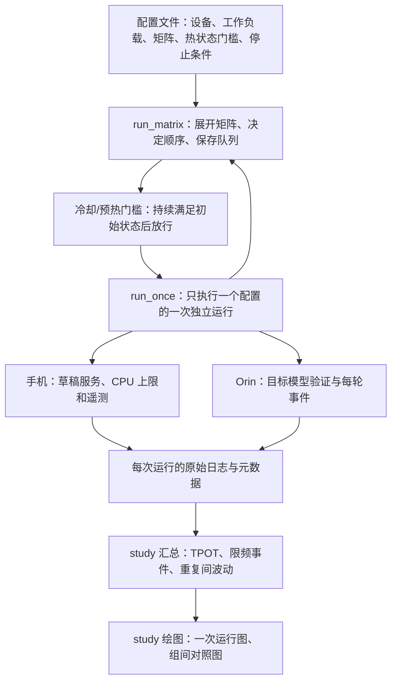

# thermSpec 实验代码框架（设计稿）

本文件规定代码边界和批量运行流程；对应的实验问题、指标和图片定义见 [动机实验执行稿](MOTIVATION_EXPERIMENTS.md)。目录与手机草稿 Demo 已初步实现；Orin 完整投机解码、正式标定和夜间稳定性验证尚未完成。

## 代码边界

目录按文档、共用机制、实验方案和论文复现分工。以下目录已迁入仓库；尚未实现的部分在各自 README 中标明。

```text
thermalSpec/
├─ README.md                           项目介绍、目录导航与快速开始
├─ docs/                               研究与实验文档
│  ├─ IDEA.md                          研究问题、相关论文与当前进度
│  ├─ MOTIVATION_EXPERIMENTS.md         实验要求、标定变量与交付图片
│  ├─ SETUP.md                         设备与模型部署
│  ├─ DATA_FORMAT.md                   原始数据格式
│  └─ WORKLOAD_AND_SAMPLING.md          数据集与采样设置
├─ configs/project.json                全局固定配置
├─ framework/                          共用运行框架
│  ├─ run_once.py                      跑一次、写盘、调用本次绘图
│  ├─ run_matrix.py                    参数矩阵、冷却等待与续跑
│  ├─ core/                            设备、采样、状态门槛和日志
│  └─ tools/                           数据集准备与诊断工具
├─ experiments/                        我们自己的实验
│  ├─ motivation/
│  │  ├─ exp1_thermal_degradation/     已有 Demo、统计与绘图
│  │  │  ├─ configs/demo_phone.json
│  │  │  ├─ summarize.py
│  │  │  ├─ plot_run.py
│  │  │  └─ plot_comparison.py
│  │  ├─ exp2_channel_thermal_k/       预留配置、统计与绘图位置
│  │  ├─ exp3_joint_f_k/
│  │  └─ exp4_method_motivation/       仅预留，设计待定
│  └─ method/                          后续方法、基线与消融
├─ reproductions/                      其他论文的复现
│  ├─ eardvfs/                         每篇有 src/、configs/、analysis/
│  ├─ pelm/
│  └─ banditspec/
├─ data/                               本地输入数据，仅 README 入 Git
├─ runs/                               本地运行记录，仅 README 入 Git
└─ tests/                              共用框架与采样的测试
```

`framework/` 只承载设备接入、单次推理、采样、停止和日志等可复用机制；`experiments/` 定义各项实验的配置矩阵、指标汇总和图片。实验进入方法阶段后，动机实验的配置和分析脚本仍独立保留。论文复现的原始实现和参数放在 `reproductions/`，运行输出统一按论文名写入 `runs/reproductions/`。

## 目录迁移说明

| 原位置 | 当前位置 |
|---|---|
| `ideas/thermSpec/` 中的研究文档 | `docs/`；原 idea README 改名为 `IDEA.md` |
| `ideas/thermSpec/experiments/core/` 与运行入口 | `framework/` |
| `ideas/thermSpec/experiments/studies/` | `experiments/` |
| 原 experiments 下的全局配置、数据与运行记录 | 根目录 `configs/`、`data/`、`runs/` |
| 带会议年份的复现目录名 | `reproductions/eardvfs/`、`pelm/`、`banditspec/`；年份保留在论文 README |

历史运行中的 `events.jsonl`、`config.resolved.json` 和其他数据内容不改写。旧快照内的路径属于当时记录；重画图时把当前实际运行目录传入分析函数，新运行则使用当前配置。迁移不把旧运行重新登记为新实验。

新配置的输出路径和绘图模块名已经变化，重新开展矩阵时使用新的 `study_id`；旧矩阵的 manifest 保留，不能修改其配置快照来绕过续跑校验。

## 执行分层



`run_once` 应能独立使用：输入一次运行配置，返回明确的成功、提前停止或失败状态，并保存原始日志及本次运行的 Demo 图片。`run_matrix` 只调度多次 `run_once`，不重新实现推理。分析和绘图只读已保存的数据，因此几个月后修改图的分箱、配色或比较方式，无需重跑设备。

## 输入接口示例（字段和数值待实现、待标定）

```yaml
study: motivation/exp1
workload: configs/prompts_v1.jsonl
k: [4]
frequency_profiles: [high, moderate]
channel_profiles: [good]
repeats: 3
run_duration_s: null             # 标定后填写；不在代码中写死
order: interleaved               # 避免先做完高档再做低档
initial_state:
  kind: S0
  cpu_temp_max_c: null           # 标定后填写
  battery_temp_max_c: null       # 标定后填写
  thermal_cap_must_be_clear: true
  actual_frequency_recovered: true
  stable_hold_s: null            # 连续达标时间
  max_wait_s: null               # 超时后标记未运行，不无限等待
stop_conditions:
  cpu_temp_max_c: null           # 安全停止线，独立于初始状态门槛
  battery_temp_max_c: null
  on_disconnection: stop_and_record
output_root: runs/motivation/exp1
```

实际参数由标定表填写和冻结。配置检查在启动前拒绝缺失门槛、无效频率档、不可用信道或不可达设备，避免夜间运行到一半才发现错误。单次入口和矩阵入口使用同一配置格式；矩阵入口把列表展开为配置组合与重复编号。初期只支持实验1所需的 S0 冷却门槛；以后实验2/3的 S1/S2 可另加预热及状态确认，不把“温度达到某值”当成已经限频。

## 夜间矩阵调度状态机

```text
PENDING → WAITING_FOR_STATE → PREFLIGHT → RUNNING → SAVED → PLOTTED
                │                 │          │
                └── timeout ──────┴── error ─┴──> FAILED（记录原因，可继续其他安全配置）
```

1. 生成并持久保存完整任务清单、随机种子和执行顺序，每个任务有稳定 `run_id`；重新启动时跳过 `PLOTTED`，只重试未完成项。重试次数有上限，不覆盖失败记录。
2. 每次运行前检查手机 CPU 与电池温度都低于**起始门槛**，温控限制解除、负载频率恢复，并连续保持预设时长；不满足就等待、采样并记录冷却过程。超过 `max_wait_s` 时标记该配置失败/跳过，继续或停止由配置决定。
3. 通过状态门槛后检查手机草稿服务、Orin 目标服务、传输路径、频率上限请求与读回。执行中独立监控安全停止线、断连和无进展超时；异常时先收束日志并恢复频率请求，再决定下一项。
4. 区分**正常温控限频事件**和**必须停止的条件**。实验1要观察前者；现有短测在热限制出现时会停止，不能原样用于持续实验。正式夜间运行前须单独核对并冻结允许观察的限频范围、硬停止条件和自动恢复步骤，始终保留系统原厂温控。
5. 只有原始数据写入完成、摘要生成且图片成功后才将任务标为 `PLOTTED`。任何一步失败都保留中间文件与原因。控制电脑必须保持唤醒、USB/SSH 隧道及服务可用；启动前做一次完整小矩阵试跑。

## 数据与复画接口

```text
runs/motivation/exp1/<run_id>/
  config.resolved.json       # 展开后的实际配置、版本、模型及提示词哈希
  status.json                # 任务状态、开始/结束时间、失败或停止原因
  events.jsonl               # 运行中持续保存的手机遥测、请求与停止事件
  phone_telemetry.csv        # 成功后从遥测导出的兼容表
  summary.json              # 当前仅手机草稿请求统计；端到端 TPOT 待接入
  plots/exp1_run.png         # 本次运行结束自动生成的 Demo 图

experiments/motivation/exp1_thermal_degradation/plots/
  exp1_comparison.png        # 汇总多个 run_id 后生成的正式对照图
```

记录原始时钟、设备来源和 `run_id`；跨设备时间轴先校准或用统一控制端事件对齐，不直接相减未同步的绝对时间戳。统一字段见 [DATA_FORMAT](DATA_FORMAT.md)。正式投机解码的 TPOT 使用最终有效输出 token；无有效输出的时间窗记为停顿/缺失，不画成 0。绘图脚本按 `run_id` 或实验配置筛选数据，不手工修改图中数值。为保证以后重画旧图，保存绘图参数、脚本版本与生成所用的 run_id 清单。

## 第一阶段的最小交付

先实现实验1需要的 `run_once`、手机遥测、原始日志和单次出图，在小负载下跑通一次完整闭环；再接 `run_matrix` 的冷却门槛、两档频率 × 3 次重复、断点续跑与组间图。历史的 [`run_phone_smoke_legacy.py`](../framework/tools/run_phone_smoke_legacy.py)用于连通和逐 token 正确性检查，可复用已验证的推理接口，但持续实验不能在每个提示词后混入 target-only 对照而改变受热工作负载。
